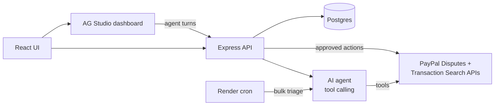

# DisputeDesk

AI dispute triage for PayPal merchants. Built for the PayPal AI Hackathon ("Build What's Next with PayPal and AI"). The project was created during the submission period.

## The problem

Merchants lose money and time on PayPal disputes. Each case means reading the buyer's claim, digging through transaction and shipping data, deciding whether to fight or refund, and writing a reply, all before a response deadline. Many small disputes are refunded without review, and many winnable ones are lost for lack of evidence.

## What it does

DisputeDesk is a review-and-approve console. An OpenAI agent investigates each dispute through the PayPal APIs and recommends what to do. The merchant approves, and the app executes the action through PayPal.

1. Lists the merchant's disputes (`GET /v1/customer/disputes`).
2. On **Run AI triage**, the agent decides which tools to call, in a loop:
   - `get_dispute_details`: the dispute record, messages and deadline (`GET /v1/customer/disputes/{id}`)
   - `get_transaction`: payer, shipping and tracking data (`GET /v1/reporting/transactions`)
   - `get_account_dispute_stats`: patterns across the account's disputes
3. It returns validated, structured output: summary, priority, win probability, fraud signals, recommended action, reasoning, evidence checklist, and drafted evidence notes and buyer message.
4. The merchant reviews and edits, then executes one of:
   - **Contest with evidence**: `POST /v1/customer/disputes/{id}/provide-evidence`
   - **Message the buyer**: `POST /v1/customer/disputes/{id}/send-message`
   - **Accept claim (refund)**: `POST /v1/customer/disputes/{id}/accept-claim`



### Insights dashboard (AG Studio)

The **Insights** tab embeds [AG Studio](https://www.ag-grid.com/studio/) with a pre-built, merchant-themed dashboard over every dispute (`GET /api/analytics`):

- **Overview** page: KPIs (open cases, money at risk, due within 3 days, average AI win estimate), money at risk by reason, open cases by AI priority, expected loss by deadline window, and money at risk by suggested action.
- **All cases** page: an AG Grid table with status and priority filters that cross-filter the grid.
- **Case queue**, a custom widget: open disputes ordered by deadline and colour-coded by urgency. Clicking a card opens the case in the case workspace.
- **Customize + Ask AI** switches to edit mode, where merchants can rearrange widgets, build their own, and use the Studio Agent Framework chat. Layout changes persist in the browser; the reset button restores the default.

The agent framework runs on the same model as triage, through `POST /api/studio-llm`, so the AI key never reaches the browser. The lead agent has two extra tools: `open_case` (opens a case for review) and `triage_open_cases` (read-only bulk triage). It cannot refund, message buyers or submit evidence; those still need approval in the case workspace.

### Bulk triage and persistence

- **Triage all open cases** (`POST /api/triage-all`) analyses every open dispute that has no stored result, a few at a time, and never writes to PayPal. Progress is at `GET /api/triage-all`.
- Triage results and the action log are stored in Postgres when `DATABASE_URL` is set, and in memory otherwise.
- `node server/dist/worker.js` runs the same bulk triage once and exits. `render.yaml` schedules it as a Render cron job so cases are already analysed when the merchant opens the app.

### Guardrails

- A human approves every PayPal write; the AI never executes actions itself.
- Server-side cap on accepted claims (`MAX_ACCEPT_AMOUNT`) and confirmation prompts for irreversible actions.
- Dispute and buyer messages are treated as untrusted data. The sample dispute `PP-D-1004` contains a prompt-injection attempt the agent must ignore.
- AI output is validated against a schema (Zod) before it reaches the UI.
- Every executed action is logged (in-app and as an `audit` JSON log line).

## Tools used

| Tool | How it is used |
| --- | --- |
| PayPal Disputes API | List, read, message, contest and accept disputes |
| PayPal Transaction Search API | Transaction, payer and shipping context for the agent |
| PayPal OAuth 2.0 | Client-credentials auth with token caching and refresh |
| OpenAI (`gpt-4o` by default) or Google Gemini (`gemini-2.5-flash` by default) | Tool-calling triage agent; OpenAI uses strict JSON-schema output, Gemini uses the OpenAI-compatible endpoint with the schema in the prompt |
| AG Studio (AG Grid) | Embedded analytics dashboard, custom case-queue widget, theming, and the Studio Agent Framework with custom tools |
| Render | Docker web service, Postgres database and cron job for scheduled triage (`render.yaml`) |

## Quick start

Requires Node 20+.

```powershell
npm install
Copy-Item .env.example .env     # use `cp` on macOS/Linux
# edit .env: set OPENAI_API_KEY (required for AI triage)
npm run dev
```

Open http://localhost:5173.

- **Without PayPal credentials** (or with `MOCK_PAYPAL=true`), the app serves eleven built-in sample disputes (item not received, unauthorised/fraud, not as described, refund not received, plus resolved cases). The full flow works against them, with state kept in memory unless `DATABASE_URL` is set. The header badge reads "Sample data".
- **With PayPal sandbox credentials**, it uses the live sandbox API. The badge reads "PayPal: sandbox live".

The **Run AI triage** button stays disabled, with a hint, until `OPENAI_API_KEY` is set and the server has been restarted.

### Use the PayPal sandbox

1. In the [PayPal Developer Dashboard](https://developer.paypal.com/dashboard/applications/sandbox) (Sandbox mode), open **Apps & Credentials** and open an app (or create one).
2. Copy the **Client ID** and **Secret key 1** into `.env` as `PAYPAL_CLIENT_ID` and `PAYPAL_CLIENT_SECRET`.
3. In the app's **Features**, enable **Disputes**, then save.
4. Restart `npm run dev`.

### Create a test dispute in the sandbox

Sandbox disputes are opened by a buyer. Create a payment from your sandbox personal account to your sandbox business account (the one that owns the app):

```powershell
$e = @{}; Get-Content .env | % { if ($_ -match '^(\w+)=(.*)$') { $e[$Matches[1]] = $Matches[2].Trim() } }
$basic = [Convert]::ToBase64String([Text.Encoding]::ASCII.GetBytes("$($e.PAYPAL_CLIENT_ID):$($e.PAYPAL_CLIENT_SECRET)"))
$tok = (Invoke-RestMethod -Method Post https://api-m.sandbox.paypal.com/v1/oauth2/token -Headers @{Authorization="Basic $basic"} -Body "grant_type=client_credentials").access_token
$h = @{Authorization="Bearer $tok"; "Content-Type"="application/json"}
$body = '{"intent":"CAPTURE","purchase_units":[{"amount":{"currency_code":"USD","value":"39.99"},"description":"Ceramic mug"}],"payment_source":{"paypal":{"experience_context":{"return_url":"https://example.com/return","cancel_url":"https://example.com/cancel","user_action":"PAY_NOW"}}}}'
$order = Invoke-RestMethod -Method Post https://api-m.sandbox.paypal.com/v2/checkout/orders -Headers $h -Body $body
($order.links | ? rel -eq "payer-action").href     # open this URL and pay as the sandbox personal account
```

After approving the payment in the browser, capture it:

```powershell
Invoke-RestMethod -Method Post "https://api-m.sandbox.paypal.com/v2/checkout/orders/$($order.id)/capture" -Headers $h -Body '{}'
```

Then log in to https://www.sandbox.paypal.com as the personal account, open the payment under **Activity** and choose **Report a problem** (or use the Resolution Center). The dispute appears in DisputeDesk after a refresh.

Sandbox account emails and passwords are under **Testing Tools > Sandbox Accounts** in the dashboard.

## Configuration

| Variable | Default | Notes |
| --- | --- | --- |
| `AI_PROVIDER` | auto | `openai` or `gemini`; blank uses whichever key is set (OpenAI first) |
| `OPENAI_API_KEY` / `OPENAI_MODEL` | none / `gpt-4o` | OpenAI provider |
| `GEMINI_API_KEY` / `GEMINI_MODEL` | none / `gemini-2.5-flash` | Gemini provider; one AI key is required for triage |
| `PAYPAL_CLIENT_ID` / `PAYPAL_CLIENT_SECRET` | none | Blank uses sample data (development only) |
| `PAYPAL_BASE_URL` | sandbox | `https://api-m.paypal.com` for live |
| `MOCK_PAYPAL` | `false` | `true` forces sample data even if credentials are set |
| `MAX_ACCEPT_AMOUNT` | `250` | Server refuses to accept larger claims |
| `BASIC_AUTH_USER` / `BASIC_AUTH_PASSWORD` | none | Enables HTTP basic auth; required in production (password 12+ chars) |
| `TRUST_PROXY` | `0` | Reverse-proxy hops, for correct per-IP rate limiting |
| `PORT` | `3001` | API and production UI port |
| `DATABASE_URL` | none | Postgres connection string; blank keeps the action log and triage results in memory |
| `TRIAGE_CONCURRENCY` | `3` | Disputes analysed in parallel by bulk triage |
| `VITE_AG_STUDIO_LICENSE` | none | AG Studio licence key, read at build time; without it the dashboard shows a trial watermark |

## Production

Set `NODE_ENV=production`. The server validates its configuration at startup and refuses to start without live PayPal credentials (no sample data), `OPENAI_API_KEY`, and basic-auth credentials.

```bash
npm run build && npm start      # serves the API and the built UI on :3001
# or
docker build -t disputedesk . && docker run --env-file .env -e NODE_ENV=production -p 3001:3001 disputedesk
```

Built in: basic auth, Helmet headers, per-route rate limits, upstream timeouts, token refresh, per-dispute action locking, JSON logs, graceful shutdown and `/healthz` for probes. Terminate TLS at a reverse proxy.

### Deploy on Render

`render.yaml` defines the web service, a Postgres database and a 30-minute cron job. Create a Blueprint from the repository, then fill the `sync: false` values (PayPal credentials, AI key, basic-auth login, optional AG Studio licence). The cron job needs the same values as the web service. For a Gemini key, add `GEMINI_API_KEY` to both services.

A free Gemini key allows about 20 requests per day, and one triage uses several, so use a paid key for bulk triage.

### Deploy on Vercel

`vercel.json` still works, but serverless functions have no persistent memory and a 60-second limit, so bulk triage runs inline and results reset between invocations. Use Render for the full experience.

## Limitations

- The in-app action log and triage results are in memory unless `DATABASE_URL` is set. The `audit` lines on stdout are always written.
- One shared login, not per-user accounts.
- Evidence submission sends notes and tracking details only, with no file attachments.
- No automated tests yet.

## Project layout

- `server/src/agent.ts`: tool-calling triage agent, prompt and output schema
- `server/src/paypal.ts`: PayPal REST client (OAuth2, disputes, transactions)
- `server/src/mock.ts`: sample data used when no PayPal credentials are set
- `server/src/index.ts`: API, validation, guardrails, security middleware
- `server/src/config.ts`: environment validation
- `client/src/App.tsx`: review and approval UI
- `client/src/Dashboard.tsx`: AG Studio dashboard, agent harness and custom tools
- `client/src/CaseQueueWidget.tsx`: custom Studio widget
- `client/src/studioAdapter.ts`: LLM adapter that routes Studio agent turns through the server
- `server/src/analytics.ts`: flat dispute rows for the dashboard
- `server/src/batch.ts`, `server/src/worker.ts`: bulk triage and its cron entry point
- `server/src/store.ts`: Postgres or in-memory persistence
- `server/src/llmProxy.ts`: server-side LLM proxy for the Studio agents
